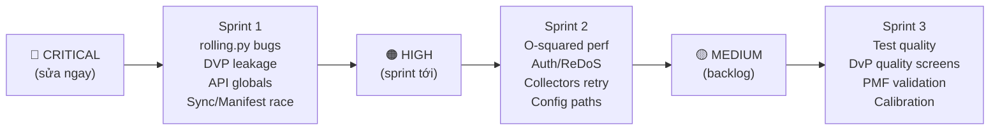

# NBA Props Prediction — Code Review Report
> Reviewed: 2026-11-13 | Branch: `feature/dvp-v1` | Tests: 122 passed

---

## Tổng quan

| Mức độ | Số lỗi | Nguồn |
| :---: | :---: | :--- |
| 🔴 **CRITICAL** | **10** | Rolling, DVP context, API startup, Sync/Manifest |
| 🟠 **HIGH** | **21** | O(n²) loops, hardcoded paths, missing auth, API stability |
| 🟡 **MEDIUM** | **21** | Validation gaps, test flakiness, caching bugs, edge cases |
| 🟢 **LOW** | **9** | DRY violations, magic constants, cosmetic bugs |

> [!CAUTION]
> 7 trong số 10 lỗi CRITICAL có thể gây **sai kết quả dự đoán im lặng** (silent wrong predictions) hoặc **data race khi tải lại server**.

---

## 🔴 CRITICAL — Cần sửa ngay

### 1. `src/features/rolling.py` — `n_games_history` bị gán sai giá trị
**Vấn đề:** Line 29 tính expanding count đúng, nhưng line 31 ngay lập tức ghi đè bằng `cumcount()` — đếm từ 0 cho mọi game, không phải số trận thực sự đã chơi. Giá trị `n_games_history` bị thổi phồng thêm 1 và tính cả DNP (trận nghỉ).

**Hướng sửa:**
```python
# Thay line 31:
df_sorted["n_games_history"] = grouped["min"].apply(
    lambda s: s.shift(1).gt(0).expanding().sum().fillna(0)
).reset_index(drop=True).astype(int)
```

---

### 2. `src/features/rolling.py` — `groupby` trên shifted Series gây lệch index
**Vấn đề:** `shifted_stat.groupby(df_sorted["player_id"]).rolling(w).mean()` — sau khi rolling multi-index được reset, nếu player có các hàng không liền kề trong df_sorted, rolling window bị gán nhầm cho các hàng sai của player khác (silent wrong values).

**Hướng sửa:**
```python
df_sorted[mean_col] = grouped[stat].apply(
    lambda s: s.shift(1).rolling(w, min_periods=1).mean()
).reset_index(drop=True)
```

---

### 3. `src/features/dvp_context.py` — Data Leakage trong DvP observations
**Vấn đề:** `compute_dvp_features` dùng `player_df` (frame có chứa stats của chính trận đang predict) để build DvP observations. Dù có cutoff `game_date < d_cutoff`, defensive team-aggregates cho cùng ngày game vẫn có thể bị bao gồm. Rủi ro lớn hơn: position assignments từ tương lai bị rò vào past predictions.

**Hướng sửa:** Tách `all_player_logs_df` (toàn lịch sử) dùng để build observations, chỉ dùng `player_df` cho prediction rows.

---

### 4. `src/features/dvp_context.py` — Global cache `_GLOBAL_DVP_OBS_CACHE` stale
**Vấn đề:** Cache chỉ kiểm tra sự tồn tại (not None), không phân biệt được nếu được gọi với DataFrame khác (ví dụ 2023-24 rồi 2024-25) — trả về observations cũ sai.

**Hướng sửa:**
```python
_cache_key = (len(player_logs_df), len(team_logs_df), str(player_logs_df.index[-1]))
```

---

### 5. `src/api/main.py` — `load_resources()` được gọi 2 lần khi startup
**Vấn đề:** Gọi ở line 170 (import time) VÀ trong `on_app_startup()` (line 200). Toàn bộ parquet, models được load đôi, có thể gây partial overwrite globals trong multi-threaded workers.

**Hướng sửa:** Xóa `load_resources()` ở line 170, chỉ giữ trong `lifespan` handler.

---

### 6. `src/api/main.py` — Shared mutable global state không có lock
**Vấn đề:** `MODELS`, `BUNDLES`, `LATEST_FEATURES_DF` là plain globals được mutate trong `load_resources()`. Concurrent reads trong quá trình reload → `KeyError` hoặc stale predictions không có error.

**Hướng sửa:** Dùng `threading.RLock` bọc quanh load/reload, hoặc pattern immutable snapshot (swap atomically một `AppState` dataclass).

---

### 7. `src/api/main.py` — Không có Auth/Rate-limit trên bất kỳ endpoint nào
**Vấn đề:** `/api/sync/run`, `/api/predict`, `/api/fastcheck/predict-batch` đều public, không cần API key. Thêm vào đó `allow_origins=["*"]` với `allow_credentials=True` là **invalid theo CORS spec** — browsers sẽ block.

**Hướng sửa:** Thêm `APIKeyHeader` dependency cho mutation endpoints; hoặc restrict `allow_origins`.

---

### 8. `src/collectors/sync.py` — Race condition khi acquire lock (TOCTOU)
**Vấn đề:** `SyncLeaseLock.acquire()` check `is_locked()` rồi mới write lock file — khoảng thời gian giữa 2 thao tác này cho phép process khác cướp lock.

**Hướng sửa:** Dùng `open(..., 'x')` (exclusive create) hoặc OS-level file locking (`msvcrt.locking` trên Windows).

---

### 9. `src/storage/manifest.py` — Non-atomic write, torn JSON khi concurrent
**Vấn đề:** `_save()` ghi thẳng vào `manifest_path`. Hai threads ghi cùng lúc → JSON bị corrupt.

**Hướng sửa:** Ghi vào temp file rồi `os.replace()` (atomic trên NTFS):
```python
tmp = manifest_path.with_suffix('.tmp')
tmp.write_text(json.dumps(data, indent=2))
os.replace(tmp, manifest_path)
```

---

### 10. `src/features/dvp_ranks.py` — `is_quality_valid` filter bị bypass hoàn toàn
**Vấn đề:** `obs.get("is_quality_valid", True) == True` — khi column vắng mặt, `DataFrame.get()` trả về scalar `True`, khiến mọi row đều pass quality screen, bỏ qua toàn bộ DvP quality gate.

**Hướng sửa:**
```python
if "is_quality_valid" in obs.columns:
    obs = obs[obs["is_quality_valid"].fillna(True)]
```

---

## 🟠 HIGH — Nên sửa trong sprint tới

### Performance (O(n²) loops — Pipeline chậm đáng kể)

| File | Vấn đề | Fix |
| :--- | :--- | :--- |
| `features/rolling.py` | `calc_decay_mean` pure Python loop O(n²) | Dùng `pandas.ewm(halflife=H)` |
| `features/schedule_context.py` | Nested loop tính 3-in-4/4-in-6 fatigue | Vectorized `searchsorted` + rolling |
| `features/schedule_context.py` | `iterrows()` gán context cho player rows | Merge on `(team_abbreviation, game_id)` |
| `features/participation.py` | O(n²) Python loop trong `compute_player_workload_context` | Groupby + shift + rolling |
| `features/context.py` | O(n²) dict scan trong `compute_opponent_defense_context` | Pivot game_id → dict |
| `features/opponent_context.py` | 2 lần O(n²) loops (lookup + apply) | Pre-build dict + vectorized merge |
| `features/dvp_context.py` | `iterrows()` trong profile expansion | Dict comprehension + `pd.concat` |
| `api/main.py` | `iterrows()` build `PLAYER_NAME_TO_MINUTES` on startup | Dict comprehension từ `.to_dict()` |

### API Stability

| File | Vấn đề |
| :--- | :--- |
| `api/main.py` | Search term unescaped vào `str.contains()` regex → **ReDoS risk** (thêm `regex=False`) |
| `api/main.py` | Batch endpoint `/fastcheck/predict-batch` không giới hạn số items → thêm max 30 |
| `api/main.py` | ESPN injury fetch đồng bộ trong endpoint → block event loop (dùng background cache) |
| `api/main.py` | `mu`/`median_val` có thể unset → `NameError` trong edge case |
| `simulation_gate/kernels.py` | `season_mbb_indices` raises exception khi segment < block_length, không được catch ở trên |

### Data Integrity

| File | Vấn đề |
| :--- | :--- |
| `config.py` | Hardcoded absolute path `D:/Project/NBA_props_prediction` → dùng `Path(__file__).parent.parent` |
| `models/trainer.py` | `features_meta.json` không được cập nhật sau training |
| `collectors/sync.py` | Parquet bị overwrite dù validation PARTIAL — data cũ bị mất |
| `collectors/boxscore.py` | Không có try/except → crash toàn bộ sync khi 1 game lỗi |
| `collectors/injuries.py` | Không có retry/backoff cho ESPN API, bare `except` swallow lỗi |
| `pipeline/backfill.py` | `run_all()` hardcode 3 mùa, bỏ sót `2026-27` từ `settings.SEASONS` |

---

## 🟡 MEDIUM — Cần đánh giá và plan

### DvP & Feature Layer
- `dvp_observations.py`: Quality screen chỉ check PTS — REB và AST không được kiểm tra
- `dvp_ranks.py`: Không có assertion 1 row per `(game_id, team, group)`
- `dvp_context.py`: `get_team_all_dvp_profiles` dùng `as_of_date="2099-01-01"` — không có guard nếu gọi từ training path
- `matchup_resolver.py`: Cache key chỉ dùng `len(df)` — stale nếu data refresh intra-session
- `matchup_resolver.py`: `valid_matches.iloc[0]` không sort theo `tipoff_dt` — có thể pick sai game
- `opponent_context.py`: `except Exception: pass` swallows toàn bộ lỗi trong enhanced rank block
- `injury_roles.py`: `games_since_return` logic cần thêm assertion dedup game_date

### API & Distribution
- `api/schemas.py`: Mutable default list trong Pydantic model (dùng `default_factory=list`)
- `distribution/engine.py`: Không validate PMF sum ≈ 1.0 trước khi trả response
- `distribution/calibration.py`: `isotonic_regression` fit trên toàn bộ data không hold-out → mild overfit calibration
- `simulation_gate/monte_carlo.py`: `n_adopt_overall` logic mâu thuẫn với `stopped_early` guard
- `simulation_gate/dgp_score.py`: `np.tile` trên resampled indices phá vỡ season-stratification

### Tests (quan trọng cho CI)
- `tests/test_api.py`: Nhiều tests depend vào actual parquet files + models → fail trong CI sạch
- `tests/test_api.py`: Hardcode path `C:/Users/Triet Duong/...` trong test → chỉ chạy được trên máy này
- `tests/test_api.py`: Assert `season == "2026-27"` hardcoded → vỡ khi season đổi
- `tests/test_api.py`: Assert player name "Stephen Curry" → vỡ khi trade/injury
- `tests/test_models.py`: Không có edge cases: NaN input, all-zero history, empty DataFrame
- `tests/test_feature_builder.py`: Chỉ test 1 player — không verify rolling independence giữa các player
- `tests/test_simulation_gate.py`: `np.random.seed(42)` legacy API — không reproducible với NumPy mới

---

## 🟢 LOW — Tech Debt

| File | Vấn đề |
| :--- | :--- |
| `dvp_ranks.py` + `opponent_ranks.py` | `compute_log_relative()` duplicate byte-for-byte → extract sang `shrinkage_utils.py` |
| `dvp_ranks.py` + `opponent_ranks.py` | `TAU_POSSESSIONS = 500.0` định nghĩa 2 lần → centralize trong `config.py` |
| `features/shrinkage.py` | `pd.merge(left_index=True, right_index=True)` fragile nếu row count lệch nhau |
| `features/rolling.py` | Column `game_date_dt` tạm thời có thể xóa nhầm nếu caller đã có sẵn |
| `features/participation.py` | Magic constants `25.0`, `75.0` → promote lên module-level constants |
| `collectors/gamelogs.py` | `round(..., 3)` trên minutes nhưng boxscore.py không round → inconsistency |
| `collectors/boxscore.py` | Duplicate key `"pace": "pace"` trong `col_map` — mask schema drift |
| `simulation_gate/variance.py` | Outer resample có thể vi phạm contiguous-season constraint |
| `simulation_gate/dgp_score.py` | `Any` import unused trong subclass annotations |

---

## Khuyến nghị ưu tiên



> [!TIP]
> Bắt đầu từ `rolling.py` CRITICAL bugs: đây là lỗi im lặng ảnh hưởng trực tiếp đến **tất cả rolling features** (`pts_roll_mean_5`, `_10`, `_20`, `decay_mean`) — sửa xong cần rebuild toàn bộ parquet và retrain models.
